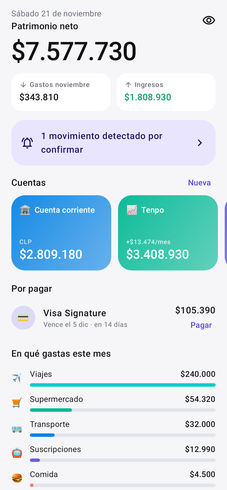

# personal_finances (nombre provisorio: *Finanzas*)

App Android de finanzas personales: minimalista, rápida y pensada para Chile (CLP primero).

<p>



</p>

## Funciones

- **Cuentas**: corriente, vista/débito, efectivo, ahorro, inversión, **remuneradas** y **tarjetas de crédito**. Multimoneda (CLP, UF, USD, EUR, GBP, ARS, BRL, MXN, PEN, COP, JPY, BTC) con patrimonio total convertido a tu moneda principal.
- **Tarjetas de crédito simples**:
  - Compras en cuotas que se reparten solas en los estados de cuenta según el **día de facturación**.
  - Interés de tres formas: **valor cuota** del banco, **total** a pagar, o **tasa mensual** (sistema francés).
  - Primera cuota diferida (+1/+2/+3 meses) y compras antiguas ("ya pagué 4 de 12").
  - Cupo usado/disponible: al pagar la tarjeta el cupo se recupera. Los intereses solo cuentan cuando se facturan.
  - Monto a pagar, vencimiento, periodo en curso y proyección de los próximos meses.
- **Cuentas remuneradas (tipo Tenpo)**: configuras la tasa anual y la app suma el interés diario compuesto automáticamente (un movimiento "Rentabilidad <mes>" que se actualiza cada día). Botón "Ajustar saldo" para cuadrar con el saldo real.
- **Detección por notificaciones** (opcional, con consentimiento explícito): lee solo las apps que elijas (bancos, Google Wallet, billeteras) y te notifica *"Gasto de $12.990 en LIDER — Registrar / Ignorar"*. Nada se guarda sin tu confirmación. Aprende qué cuenta corresponde a cada app/tarjeta y qué categoría a cada comercio.
- **Movimientos recurrentes**: marca "Cada mes/semana/año" al agregar un movimiento (sueldo, arriendo, suscripciones). Cuando llega la fecha queda en la bandeja para confirmar, o se registra solo si lo marcas como automático. Sección "Próximos" en Inicio.
- **Proyección de saldo**: saldo disponible día a día considerando recurrentes, pagos de tarjetas en su vencimiento y rentabilidad. Punto más bajo, tabla mes a mes y desde cuándo quedas sin cuotas.
- **Compras en otra moneda**: ingresa US$/€ en una cuenta en pesos; la app convierte con la tasa del día o usas el monto que cobró el banco. Se guarda el monto original.
- **Cargar datos pasados sin descuadres**: el saldo que ingresas al crear la cuenta es el de hoy y lo anterior queda como historial; en tarjetas indicas el último estado pagado. Botón "Guardar y otro" para cargar rápido.
- **Presupuestos** por categoría o total del mes: barra de avance, cuánto puedes gastar por día, aviso si vas más rápido de lo normal y alertas al 80% y 100%. Sugiere el monto según tu promedio de 3 meses.
- **Reportes** (pestaña propia): gastos del mes y variación vs. el anterior, ingresos, ahorro y tasa de ahorro, promedio diario, gasto estimado a fin de mes, dona por categoría, tendencia de 6 meses y dónde más gastaste.
- **Favoritos**: los movimientos que repites (ej. "☕ Café $3.500") aparecen como atajos en la hoja rápida.
- **Metas de ahorro**: asociadas a una cuenta (el avance es su saldo y considera su rentabilidad) o con abonos a mano; con fecha límite te dice cuánto ahorrar al mes.
- **Animaciones**: la tarjeta de cada cuenta se transforma en su pantalla de detalle, gesto "atrás" predictivo (Android 14+) y splash screen hasta que los datos están listos.
- **Créditos de consumo e hipotecarios** (también en UF): deuda calculada con el sistema francés, cuotas pagadas, intereses por pagar y fecha del último pago; la deuda en UF se valoriza en pesos con la UF del día. Botón "Pagar cuota".
- **Reconoce débito vs. crédito**: usa las palabras de la notificación ("crédito", "débito", "cuenta corriente"…), los últimos dígitos (varios por cuenta: tarjeta física, virtual, débito) y lo que aprendió de tus confirmaciones.
- **Deslizar** un movimiento para eliminarlo (con "Deshacer") o duplicarlo. Widget de **tarjetas** con cupo y próximo pago.
- **Recordatorios de tarjetas**: 3 días antes del vencimiento, el día del vencimiento y el día de cierre (nunca de noche).
- **Agregar rápido**: widget de pantalla de inicio, tile en ajustes rápidos, accesos directos del ícono (mantener presionado) y teclado numérico propio.
- **Respaldo**: los datos viven solo en el teléfono (Room). Respaldo automático semanal a una carpeta que elijas (guarda los últimos 6), exportar/importar JSON manual y backup automático de Android.
- Tasas USD/EUR/UF actualizadas solas una vez al día desde [mindicador.cl](https://mindicador.cl), o manuales.
- Bienvenida de 3 pasos la primera vez.
- **Seguridad**: bloqueo con huella/rostro/PIN (inmediato o tras 1, 5 o 15 min en segundo plano) y protección de pantalla (oculta la app en recientes y bloquea capturas).
- Tema claro/oscuro/Material You, ocultar montos.

## Stack

Kotlin · Jetpack Compose (Material 3) · Room · DataStore · WorkManager · Glance (widget) · kotlinx.serialization. minSdk 26, targetSdk 35. Sin servidores ni dependencias de terceros más allá de AndroidX.

```
app/src/main/java/com/personalfinances/
├── domain/         # Lógica pura y testeada: Money, CardCycle, InstallmentPlanner, CardCalculator, YieldAccrual
├── data/           # Room (entidades, DAOs), repositorio, snapshot calculado, DataStore, backup, tasas
├── notifications/  # NotificationListenerService, parser de notificaciones, notificación de confirmación
├── work/           # Worker de rentabilidad diaria
├── widget/         # Widget Glance + tile de ajustes rápidos
└── ui/             # Tema, componentes, pantallas, MainActivity, QuickAddActivity
```

## Compilar

Requiere JDK 17+ y Android SDK (o abrir en Android Studio).

```bash
./gradlew :app:assembleDebug          # APK debug
./gradlew :app:assembleRelease        # APK release (firmado con clave debug por ahora)
./gradlew :app:testDebugUnitTest      # tests de dominio, parser y capturas (Robolectric)
```

GitHub Actions compila ambos APK en cada push (pestaña *Actions* → artefacto `apks`).

## Releases firmados

Usa los mismos secretos que tus otras apps, o crea una clave nueva. Una sola vez:

1. Ejecuta `scripts/create-keystore.sh` en tu computador (necesita Java). Crea `finanzas-release.jks` y `keystore.properties`, ambos fuera de git.
   **Guarda el `.jks` y la contraseña en un gestor de contraseñas**: si se pierden, las actualizaciones ya no se podrán instalar sobre la app.
2. Carga los secretos `KEYSTORE_BASE64`, `KEYSTORE_PASSWORD` y `KEY_ALIAS` (opcional `KEY_PASSWORD` si la clave tiene otra contraseña) en *Settings → Secrets and variables → Actions*. El script lo hace solo si tienes `gh` instalado.

Después, para publicar una versión, sube `versionCode`/`versionName` en `app/build.gradle.kts` y:

```bash
git tag v0.2.0 && git push origin v0.2.0
```

El workflow *Release* corre los tests, firma el APK, verifica que no sea la clave debug y lo publica en *Releases*.

Las capturas de `docs/screenshots` se generan con `ScreenshotTest` (Robolectric) en `app/build/screenshots`.

## Cómo funciona el ciclo de la tarjeta

Un periodo se identifica por el mes en que **cierra** el estado de cuenta. Con cierre día 20 y pago día 5:
una compra del 15/03 se factura en el estado de marzo (vence 5/04); una del 22/03 en el de abril.
Cada cuota `k` de una compra cae en el periodo `primero + k - 1`.

- **A pagar** = cuotas de periodos cerrados − pagos/abonos.
- **Cupo usado** = cuotas facturadas (con interés) + capital de cuotas futuras − pagos.
