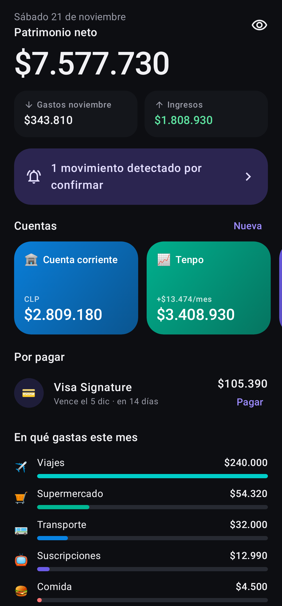
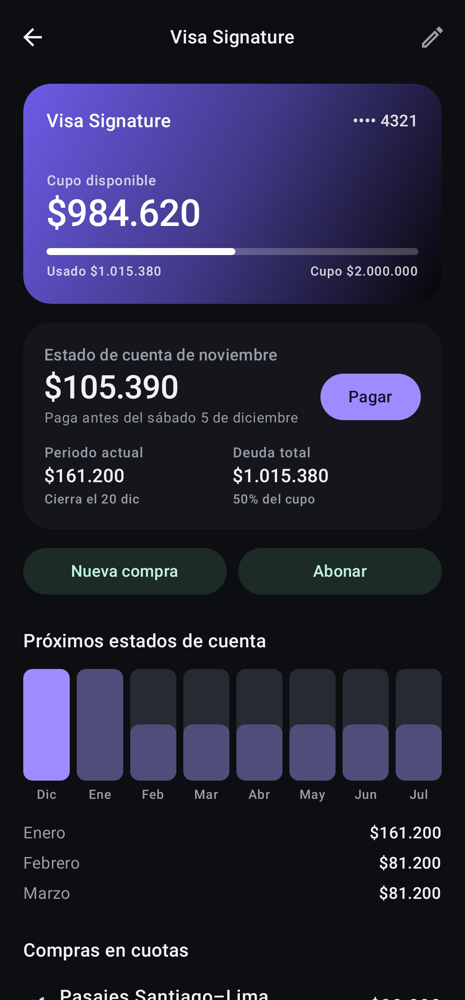
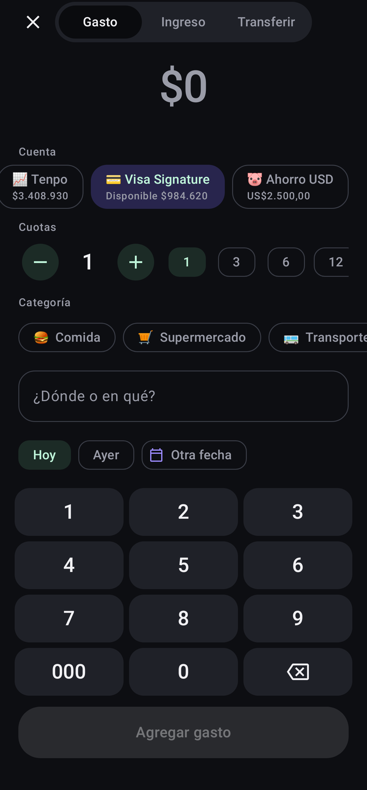

# personal_finances (nombre provisorio: *Finanzas*)

App Android de finanzas personales: minimalista, rápida y pensada para Chile (CLP primero).

<p>




</p>

## Funciones

- **Cuentas**: corriente, vista/débito, efectivo, ahorro, inversión, **remuneradas** y **tarjetas de crédito**. Multimoneda (CLP, UF, USD, EUR, GBP, ARS, BRL, MXN, PEN, COP, JPY, BTC) con patrimonio total convertido a tu moneda principal.
- **Tarjetas de crédito simples**:
  - Compras en cuotas que se reparten solas en los estados de cuenta según el **día de facturación**.
  - Interés de tres formas: **valor cuota** del banco, **total** a pagar, o **tasa mensual** (sistema francés).
  - Primera cuota diferida (+1/+2/+3 meses) y compras antiguas ("ya pagué 4 de 12").
  - Cupo usado/disponible: al pagar la tarjeta el cupo se recupera. Los intereses solo cuentan cuando se facturan.
  - Monto a pagar, vencimiento, periodo en curso y proyección de los próximos meses.
- **Cuentas remuneradas (tipo Tenpo)**: configuras la tasa anual y la app suma el interés diario compuesto automáticamente (un movimiento "Rentabilidad <mes>" que se actualiza cada día). Botón "Ajustar saldo" para cuadrar con el saldo real.
- **Detección por notificaciones** (opcional, con consentimiento explícito): lee solo las apps que elijas (bancos, Google Wallet, billeteras) y te notifica *"Gasto de $12.990 en LIDER — Registrar / Ignorar"*. Nada se guarda sin tu confirmación. Aprende qué cuenta corresponde a cada app/tarjeta y qué categoría a cada comercio.
- **Agregar rápido**: widget de pantalla de inicio, tile en ajustes rápidos, accesos directos del ícono (mantener presionado) y teclado numérico propio.
- **Respaldo**: los datos viven solo en el teléfono (Room). Exportar/importar JSON (puedes guardarlo en Google Drive) + backup automático de Android.
- Tasas USD/EUR/UF desde [mindicador.cl](https://mindicador.cl) (opcional) o manuales.
- Tema claro/oscuro/Material You, ocultar montos.

## Stack

Kotlin · Jetpack Compose (Material 3) · Room · DataStore · WorkManager · Glance (widget) · kotlinx.serialization. minSdk 26, targetSdk 35. Sin servidores ni dependencias de terceros más allá de AndroidX.

```
app/src/main/java/com/personalfinances/
├── domain/         # Lógica pura y testeada: Money, CardCycle, InstallmentPlanner, CardCalculator, YieldAccrual
├── data/           # Room (entidades, DAOs), repositorio, snapshot calculado, DataStore, backup, tasas
├── notifications/  # NotificationListenerService, parser de notificaciones, notificación de confirmación
├── work/           # Worker de rentabilidad diaria
├── widget/         # Widget Glance + tile de ajustes rápidos
└── ui/             # Tema, componentes, pantallas, MainActivity, QuickAddActivity
```

## Compilar

Requiere JDK 17+ y Android SDK (o abrir en Android Studio).

```bash
./gradlew :app:assembleDebug          # APK debug
./gradlew :app:assembleRelease        # APK release (firmado con clave debug por ahora)
./gradlew :app:testDebugUnitTest      # tests de dominio, parser y capturas (Robolectric)
```

GitHub Actions compila ambos APK en cada push (pestaña *Actions* → artefacto `apks`).

Las capturas de `docs/screenshots` se generan con `ScreenshotTest` (Robolectric) en `app/build/screenshots`.

## Cómo funciona el ciclo de la tarjeta

Un periodo se identifica por el mes en que **cierra** el estado de cuenta. Con cierre día 20 y pago día 5:
una compra del 15/03 se factura en el estado de marzo (vence 5/04); una del 22/03 en el de abril.
Cada cuota `k` de una compra cae en el periodo `primero + k - 1`.

- **A pagar** = cuotas de periodos cerrados − pagos/abonos.
- **Cupo usado** = cuotas facturadas (con interés) + capital de cuotas futuras − pagos.
